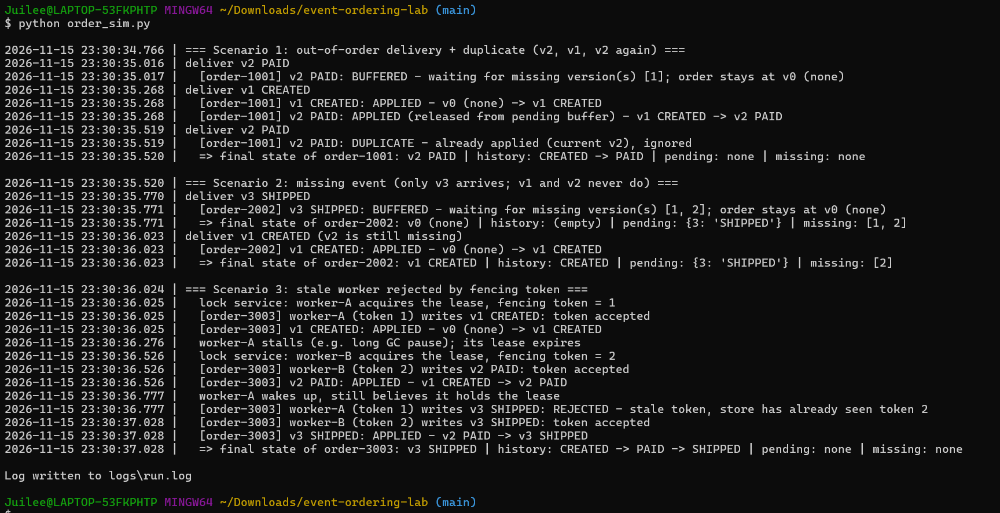
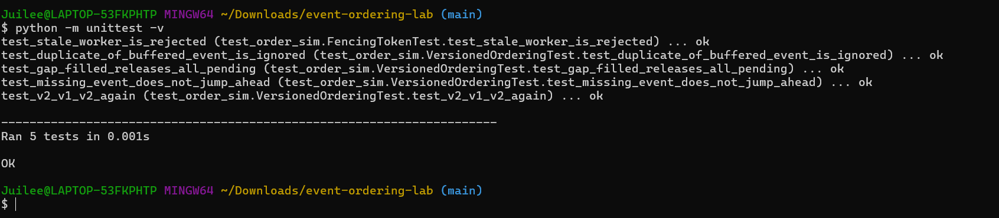

# Event Ordering, Delayed Messages, and Stale Workers

A small order-processing simulation in Python. An order moves through versioned states:

```
CREATED (v1) -> PAID (v2) -> SHIPPED (v3)
```

Events may arrive late, out of order, or more than once, and two workers may both believe they own the same order. The program shows how version numbers and fencing tokens keep the order's state correct anyway.

## How to run

Requires Python 3.9+ and nothing else (standard library only).

```bash
python order_sim.py
```

```bash
python -m unittest -v
```

Every line the simulation prints carries a wall-clock timestamp, and the same lines are written to [`logs/run.log`](logs/run.log).

| File | Purpose |
| --- | --- |
| `order_sim.py` | The `OrderStore`, `LockService`, and the three demo scenarios |
| `test_order_sim.py` | Unit tests asserting the same behaviour |
| `logs/run.log` | Timestamped log of the run shown below |
| `screenshots/` | Screenshots of my terminal for the run shown below |

## How it works

Every update is an `OrderEvent(order_id, version, status)`. The `OrderStore` keeps, per order, the last applied version, a buffer of pending events, and the highest fencing token it has seen.

When an event arrives (`OrderStore.receive`):

| Condition | Result |
| --- | --- |
| `version <= applied version` | **DUPLICATE** - ignored |
| `version` already in the pending buffer | **DUPLICATE** - ignored |
| `version > applied version + 1` | **BUFFERED** - held as pending, missing versions reported, state unchanged |
| `version == applied version + 1` | **APPLIED** - then any consecutive pending versions are released in order |

When a worker writes (`OrderStore.write`), the fencing token is checked first: a token lower than the highest one already seen is **REJECTED** before the event is even looked at.

The timestamps in the log are for evidence only. No ordering decision in the code reads a clock; ordering comes from `version` and `token` alone.

## Evidence

Screenshot of my terminal running `python order_sim.py` (all three scenarios):



The sections below quote the logs from that same run, which are also saved in [`logs/run.log`](logs/run.log).

### 1. Correct event ordering (delivery order: v2, v1, v2 again)

```
2026-11-15 23:30:34.766 | === Scenario 1: out-of-order delivery + duplicate (v2, v1, v2 again) ===
2026-11-15 23:30:35.016 | deliver v2 PAID
2026-11-15 23:30:35.017 |   [order-1001] v2 PAID: BUFFERED - waiting for missing version(s) [1]; order stays at v0 (none)
2026-11-15 23:30:35.268 | deliver v1 CREATED
2026-11-15 23:30:35.268 |   [order-1001] v1 CREATED: APPLIED - v0 (none) -> v1 CREATED
2026-11-15 23:30:35.268 |   [order-1001] v2 PAID: APPLIED (released from pending buffer) - v1 CREATED -> v2 PAID
2026-11-15 23:30:35.519 | deliver v2 PAID
2026-11-15 23:30:35.519 |   [order-1001] v2 PAID: DUPLICATE - already applied (current v2), ignored
2026-11-15 23:30:35.520 |   => final state of order-1001: v2 PAID | history: CREATED -> PAID | pending: none | missing: none
```

- **Waits for the missing version:** v2 arrives first (23:30:35.016) and is buffered; the order stays at v0.
- **Applies in the correct order:** v1 arrives about 250 ms later and is applied, then v2 is released from the buffer. History is `CREATED -> PAID`, even though PAID has the earlier arrival timestamp.

### 2. Duplicate handling

The third delivery in the scenario above is the duplicate:

```
2026-11-15 23:30:35.519 | deliver v2 PAID
2026-11-15 23:30:35.519 |   [order-1001] v2 PAID: DUPLICATE - already applied (current v2), ignored
```

The history still contains `PAID` exactly once. A duplicate of an event that is still sitting in the pending buffer is also ignored (covered by `test_duplicate_of_buffered_event_is_ignored`).

### 3. Missing-event case

Only v3 is sent; v1 and v2 are missing.

```
2026-11-15 23:30:35.520 | === Scenario 2: missing event (only v3 arrives; v1 and v2 never do) ===
2026-11-15 23:30:35.770 | deliver v3 SHIPPED
2026-11-15 23:30:35.771 |   [order-2002] v3 SHIPPED: BUFFERED - waiting for missing version(s) [1, 2]; order stays at v0 (none)
2026-11-15 23:30:35.771 |   => final state of order-2002: v0 (none) | history: (empty) | pending: {3: 'SHIPPED'} | missing: [1, 2]
2026-11-15 23:30:36.023 | deliver v1 CREATED (v2 is still missing)
2026-11-15 23:30:36.023 |   [order-2002] v1 CREATED: APPLIED - v0 (none) -> v1 CREATED
2026-11-15 23:30:36.023 |   => final state of order-2002: v1 CREATED | history: CREATED | pending: {3: 'SHIPPED'} | missing: [2]
```

- **The order does not jump ahead:** it stays at v0 rather than becoming SHIPPED, and after v1 arrives it stops at CREATED because v2 is still absent.
- **The missing version is detected and recorded:** v3 is held in `pending`, and the store reports `missing: [1, 2]`, then `missing: [2]`.

### 4. Stale-worker rejection (fencing tokens)

Worker A takes the lease (token 1), stalls, and its lease expires. Worker B takes over (token 2). Worker A then wakes up and tries to write with its old token.

```
2026-11-15 23:30:36.024 | === Scenario 3: stale worker rejected by fencing token ===
2026-11-15 23:30:36.025 |   lock service: worker-A acquires the lease, fencing token = 1
2026-11-15 23:30:36.025 |   [order-3003] worker-A (token 1) writes v1 CREATED: token accepted
2026-11-15 23:30:36.025 |   [order-3003] v1 CREATED: APPLIED - v0 (none) -> v1 CREATED
2026-11-15 23:30:36.276 |   worker-A stalls (e.g. long GC pause); its lease expires
2026-11-15 23:30:36.526 |   lock service: worker-B acquires the lease, fencing token = 2
2026-11-15 23:30:36.526 |   [order-3003] worker-B (token 2) writes v2 PAID: token accepted
2026-11-15 23:30:36.526 |   [order-3003] v2 PAID: APPLIED - v1 CREATED -> v2 PAID
2026-11-15 23:30:36.777 |   worker-A wakes up, still believes it holds the lease
2026-11-15 23:30:36.777 |   [order-3003] worker-A (token 1) writes v3 SHIPPED: REJECTED - stale token, store has already seen token 2
2026-11-15 23:30:37.028 |   [order-3003] worker-B (token 2) writes v3 SHIPPED: token accepted
2026-11-15 23:30:37.028 |   [order-3003] v3 SHIPPED: APPLIED - v2 PAID -> v3 SHIPPED
2026-11-15 23:30:37.028 |   => final state of order-3003: v3 SHIPPED | history: CREATED -> PAID -> SHIPPED | pending: none | missing: none
```

- **The newer token can update:** worker B (token 2) writes PAID and SHIPPED successfully.
- **The older token is rejected:** worker A's write at 23:30:36.777 is refused even though v3 was the next valid version, because the store had already seen token 2. The check happens at the store, so it does not depend on worker A realising its lease expired.

### 5. Unit tests

Output of `python -m unittest -v`:



```
test_stale_worker_is_rejected (test_order_sim.FencingTokenTest.test_stale_worker_is_rejected) ... ok
test_duplicate_of_buffered_event_is_ignored (test_order_sim.VersionedOrderingTest.test_duplicate_of_buffered_event_is_ignored) ... ok
test_gap_filled_releases_all_pending (test_order_sim.VersionedOrderingTest.test_gap_filled_releases_all_pending) ... ok
test_missing_event_does_not_jump_ahead (test_order_sim.VersionedOrderingTest.test_missing_event_does_not_jump_ahead) ... ok
test_v2_v1_v2_again (test_order_sim.VersionedOrderingTest.test_v2_v1_v2_again) ... ok

----------------------------------------------------------------------
Ran 5 tests in 0.001s

OK
```

## Reflection

**Why are timestamps alone not enough to guarantee correct event ordering in a distributed system?**

Each machine has its own physical clock, and those clocks drift and are only loosely synchronised, so a timestamp from one node cannot be reliably compared with a timestamp from another; an event that happened later can carry an earlier time. Clocks can also jump backwards after an NTP correction, and two events can receive the same timestamp, which leaves their order undefined. A timestamp also says nothing about gaps: if the store receives an event stamped 10:05, it cannot tell whether an earlier event is still in transit, whereas receiving version 3 while at version 1 makes it obvious that version 2 is missing. Finally, a worker that was paused does not know its lease expired, so its own clock gives no protection against it making a stale write. Logical counters assigned by one authority, such as the version numbers and fencing tokens used here, give an order that is unambiguous, gap-detectable, and independent of any wall clock.
